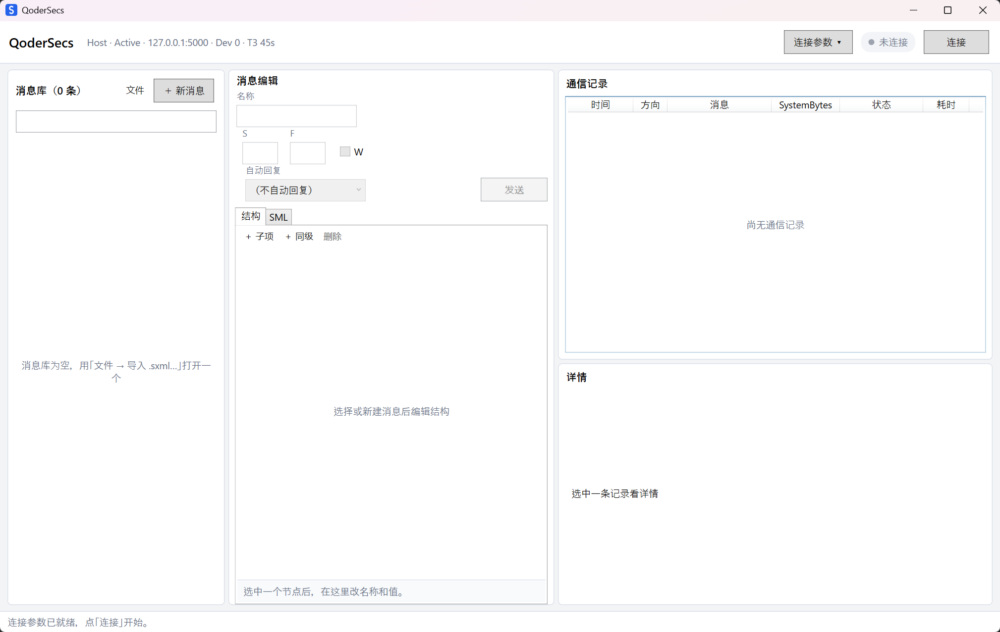

# QoderSecs

自用的 SECS/GEM 模拟器，Windows 桌面版，界面只有中文。可以做 Host 去测真实机台的参数，也可以做 Equipment 来测 CIM 系统。

传输层现状：

- **HSMS-SS（TCP）**：主要模式，也是默认模式，完整可用，日常在用的就是这条。
- **SECS-I（串行块传输）**：串口、会话层和界面入口都已接上，界面上能选；块格式、ENQ/EOT/ACK/NAK 握手、多块拼消息、T1/T2/T4 都有自动化测试。只做点对点；控制块（SELECT、ENABLE 那一类）和多点共线没做。真串口上的时序还要接对端实测。

<p align="center">
  
</p>

## 功能

**连接**
- 传输方式可选 `HSMS` 或 `SECS I`，默认 HSMS；选 SECS I 时参数区换成串口参数。
- Role（Host / Equipment）和 Active / Passive 是两个独立设置。
- HSMS 可填 IP、Port、Dev ID 和 T3/T5/T6/T7/T8；SECS I 可填串口号、波特率、数据位、校验、停止位、流控和 T1/T2/T4，两端参数要一致。改动自动落盘，连接期间锁定。
- 一个进程跑一条连接，要两条就开两个实例。

**消息库**
- 导入导出 SecsExpress 的 `.sxml`；也可以把 `.sxml` / `.xml` 直接拖到左栏，库里已有消息时先确认再整体替换。
- 以原始 XML 为权威数据，只局部改写编辑过的节点；DataDictionary、Maps、未知元素和属性、注释、消息顺序都保留。
- 消息行的 SxFy 后面带 W 位记号：`W` 表示需要回复，`-` 表示不需要。
- 搜索支持消息名、`S10F3`、`10 3`；消息按 SxFy 升序排列。
- 消息名必须非空且不能重名；SxFy 可以重复——三条 `S2F41` 分别叫 START、STOP、PP_SELECT 是正常用法。
- 消息头第二行的「描述」框编辑 `Description`，占满整行，按回车或点到空白处就保存；左栏鼠标停在消息上会显示描述，描述为空则不弹。
- 条目可新建、复制、删除。复制出来的除名字外全部照抄，名字取「原名 Copy」，紧跟原条之后；删除前弹确认，并报出有几条自动回复指向它——删完这些引用一并置空。不做撤销。

**结构编辑**
- 树状编辑 L、A、B、Boolean、I1/I2/I4/I8、U1/U2/U4/U8、F4/F8。类型菜单和选择弹层只列这些代号，不写中文解释；15 格排成 3 行 5 列，Boolean 缩成 BOOL，色块和结构树同色，方向键可走；字典页的「新增数据」用同一套。
- 数值和 Boolean 支持数组，`<I2> 0 0` 这种一个元素多个值可以直接编辑也能发出去；值框里多个值用空格分隔，存进 SXML 就是同一个 `<Value>` 里空格分开，和 SecsExpress 导出的写法一致。A、J、B 的 `[个数]` 是字节数，正文按一段对待。
- B 类值可以照日志里的写法带 `0x`，提交时自动去掉（`0x00 0X1F 2A` → `00 1F 2A`）；填 `-1` 到 `-127` 之间的负数时按二补码换成两位十六进制（`-45` → `D3`），超出这个范围照旧算不合法。这些转换只在提交时做，打字过程中不动输入。
- 「+子项」「+同级」、复制、粘贴、存入字典、删除都在工具栏；右键菜单里也有，Insert 就地打开这个菜单。Delete 删除、F2 或在那一行双击改名和值，边敲边校验，按回车、点到别的行或点到空白处都收框并保存。
- 元素描述在底部「描述」小框里编辑（固定 180 宽），不显示在树行上；鼠标停在元素上才看得到，没写描述就不弹。描述按元素写进 SXML，不参与发送。
- 节点可以复制粘贴，也可以拖动：结构页里拖动是搬动，字典页里拖进别的条目放下去的是副本、原来那一条不动（条目互不隶属），顶层条目之间拖动是排队。值不合法时标红并禁止发送。
- SML 页签可预览整条消息，也可以粘贴一条 SML 覆盖当前消息的头和结构。

**数据字典**
- 结构页把任意节点「存入字典」，字典页当素材库用。
- 菜单：新增数据（选类型）、删除条目、复制、粘贴；条目内部可以就地改名称和值、加子项、删某一层，操作和结构页同一套。
- 条目之间互不隶属；条目和消息之间是复制关系，改哪一边都不影响对方。
- 从字典拖不进消息，跨段只能复制粘贴。

**收发与配对**
- W-bit 请求的 Secondary 严格按 SystemBytes 配对，不按 SxFy 或到达时间猜。
- T3 超时明确显示；超时后才到的回复标成迟到回复；没有人等待的 Secondary 明确报出来。
- 等回复期间可以点「取消等待」，发送按键立刻放开；点「断开」同样会叫停在途的等待。取消掉的只是「等」这件事——消息已经发出去了，对方后来真回了会记成迟到回复。

**自动回复**
- 唯一来源是库里那条 SxFy 上配的 `AutoReply` 字段，值是另一条消息的 Name。
- 收到带 W 的 Primary 时把它的结构发出去，W 位强制为 0；没配、找不到或发不出去就不回复，并记录未自动回复。
- 默认不开启，不内置任何规则，不按 `SxF(y+1)` 推导。
- 那一栏的候选写成「SxF · 名字」，字段标题带上本条的 SxF 和 W 位；只支持指向一条消息，当前选中是哪条看下拉框自己的高亮，候选上不再附加配对标记。程序始终按名字精确回。
- 引用按名字存，所以目标被改名或删除时指着它的 `AutoReply` 一并置空，候选栏里也不再出现旧名字；状态栏会写明置空了哪几条。
- 「文件 → 检查自动回复…」扫一遍整库，报四种问题：目标不存在、指向自己、同 SxFy 有多条配置只认第一条、目标名对应多条消息；只报不改。

**通信记录与日志**
- 记录方向、SxFy、名称、SystemBytes、状态和耗时，请求与回复的配对关系直接可见；两个区域各自智能滚动。
- 栏头筛选框按 S+F 过滤：`S6`、`S6F11`、`10 3` 都认。写法不对就地标红提示，不弹窗。筛选只改列表视图，期间到达的记录照样进集合，点「取消」全部回来。
- 右栏上下两块之间的分栏条可以拖，通信进行中也能拖；「查看日志」打开当前会话的日志目录，没连过时按钮是灰的。
- 内存里保留最近 5000 条，超出的最早的被丢掉，标题上说明丢了几条。
- 磁盘上 `sml.log` 是完整 SML，`detail.log` 是连接事件、协议头、SystemBytes、耗时、异常和回复来源。
- 每个配置保留最近 20 个会话日志目录。

**大消息**
- 不设 4KB 那类应用层上限；列表只长期持有轻量元数据并开启虚拟化，大 SML 默认折叠。
- 1MB 和 10MB 的 B 数据双向收发验证过，界面不冻结。
- 单个值超过 256K 字符时，树行和输入框都不展开正文，只报大小（B 按字节数算）。要换正文就把整段复制到剪贴板后点「用剪贴板替换…」，或者直接把文本拖进那一栏；正文绕开输入框整段写进去。普通尺寸的值照旧就地编辑。
- 值输入框高度固定、不自动换行，长正文不会把中间栏撑开。
- 文本框的显示上限（预览 256KB、详情一次 512KB）只是显示限制，超出部分指向 `sml.log`。

**数据位置**
- 都在 exe 旁的 `QoderSecsData/`：`settings.json`、`rich-set.sxml`、`raw-set.sxml` 和 `logs/<配置 Id>/<时间_进程号>/`。
- 日志目录带进程号，多个实例不互相覆盖；参数文件共用一份，谁后保存谁生效。

## 项目结构

```
QoderSecs.sln
src/
├─ QoderSecs.Core/    协议、消息库、自动回复、配置和日志（不引用 WPF）
└─ QoderSecs.App/     WPF 界面与 ViewModel
tests/
└─ QoderSecs.Tests/   单元测试、契约测试和 HSMS 回环集成测试
release/             单文件发布产物，唯一发布落点（不进版本库）
```

Host 和 Equipment 是同一套代码，角色只是配置里的一个字段。

## 上手

发布产物是单个 `QoderSecs.App.exe`，Releases 里可以直接下载。目标机需要 [.NET 8 Windows Desktop Runtime](https://dotnet.microsoft.com/download/dotnet/8.0)（x64，框架依赖，exe 里不含运行时）。自己构建：

```
dotnet publish src/QoderSecs.App/QoderSecs.App.csproj \
  --configuration Release \
  --runtime win-x64 \
  --self-contained false \
  -p:PublishSingleFile=true
```

发布产物固定落在仓库根的 `release\`（`PublishDir` 写在 csproj 里），不要再 `-o` 到 `artifacts\` 或 `bin\...\publish`。`src\...\bin\Release\` 只是编译缓存，不是可分发版本；发布前先关掉正在运行的实例。

第一次启动时，程序会在 `QoderSecsData/` 里解出 `rich-set.sxml` 和 `raw-set.sxml` 两份样本，`settings.json` 和 `logs/` 也在同一个目录里，所以 exe 所在目录必须可写。解出来的样本只是普通文件，改它、删它、换成自己的都不受影响。启动后消息库是空的，样本不自动加载，要用的自己导入或拖进左栏。

`rich-set.sxml` 里是 40 条 GEM 常用命令的骨架：结构留着、变量名按标准填（`SVID`、`RPTID`、`CEID`、`CEED`、`RCMD`、`PPID`、`TID`、`MAP_XY`、`WAFER_MAP` 这些），数值一律空着，编号和取值按你手上那台机填。消息名不再带 `SxFy_` 前缀，SxFy 照旧单独存；不写 `Description`——应答和回包属于常识。带 W 的请求都配好了 `AutoReply`，包括 S7F3/4、S7F5/6 和按 E5 配对的 S12F9→F10、S12F15→F16。S10F3 的 TID 和 TEXT 在样本里留空，发之前先填，TID 一般写 `00`。数据字典不在样本里预置，要用在「数据字典」页自己加。

`raw-set.sxml` 只有最常见的五对：S1F1/2、S1F13/14、S2F41/42、S5F1/2、S6F11/12。请求都配了自动回复，`MDLN`、`SOFTREV`、`COMMACK`、`RCMD`、`HCACK`、`ALCD`/`ALID`/`ALTX`、`DATAID`/`CEID`/`RPTID` 和各个 ACK 都填着默认值，两边都导入这一份就能直接走完一轮，不用先改数据。

本机测一对 HSMS 连接：开两个 exe 实例，一个填 Active、一个填 Passive，地址用 `127.0.0.1`，先点 Passive 那边再点 Active。程序只提供 `127.0.0.1` 的默认参数，不含任何真实设备信息。

本机测一对 SECS I 连接：需要先有一对虚拟串口（例如 com0com，装好后在设备管理器里能看到成对的两个 COM 号）。两个实例都选 `SECS I`，分别填这一对的两个 COM 号，波特率、数据位、校验、停止位、流控保持一样，先开 Passive 再开 Active。虚拟串口能验块格式、握手、会话和日志，验不了真实线缆下的 T1/T2/T4 时序。

偶数 F 的消息（S12F16、S1F2 这类）在 SECS 里是应答，必须作为某条 W 请求的回复、沿用那条请求的 SystemBytes。把它当普通消息手动发出去时，对端一般按「无人等待的应答」丢掉；要测回复方向，让对面发请求、这边用 AutoReply 回。

## 没做

SECS-I 的控制块（SELECT、ENABLE 那一类）和多点共线；完整 GEM 数据模型和状态机；条件自动回复、脚本、变量和流程编排；内置自动回复规则和按 `SxF(y+1)` 推导；多候选自动回复选择；手动回复；独立 hex 面板；单进程多连接；撤销。

## 开发

```
dotnet build QoderSecs.sln --configuration Release
dotnet test  QoderSecs.sln --configuration Release --no-build
```

回环测试在 `127.0.0.1` 上起一对 Active / Passive 实例互连，覆盖 SystemBytes 配对、T3 超时、迟到回复、自动回复、终端显示（S10F3/S10F4）和断开清理。SECS-I 的自动化测试跑在内存双向管道上，覆盖块格式、握手、多块拼消息和会话收发；真正走串口的那一段要虚拟串口或两台机器，自动化测试替不了。

依赖：Secs4Net 3.1.0、Secs4Net.Sml 3.1.0（协议）、System.IO.Ports 8.0.0（串口）、MSTest 4.0.2（只在测试里）。C# / .NET 8，WPF + MVVM。

这个项目推荐用 AI Agent 来写、来读：核心逻辑不碰 WPF、测试一条命令跑完、模块职责单一，Agent 拿到一句话需求就能定位到该改的地方。

## 致谢

- SecsExpress —— 日常测试中一直在用的 SECS/GEM 模拟器。本项目的消息库格式、命令组织和使用习惯都重点参考了它。
- [Secs4Net](https://github.com/mkjeff/secs4net)（MIT）—— SECS/GEM 协议实现。

## 许可证

MIT，见 [LICENSE](LICENSE)。
